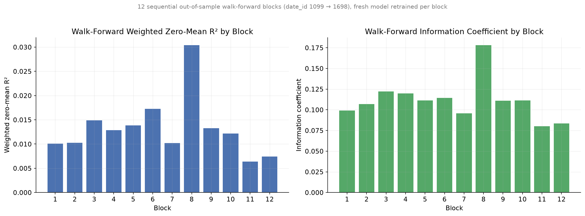
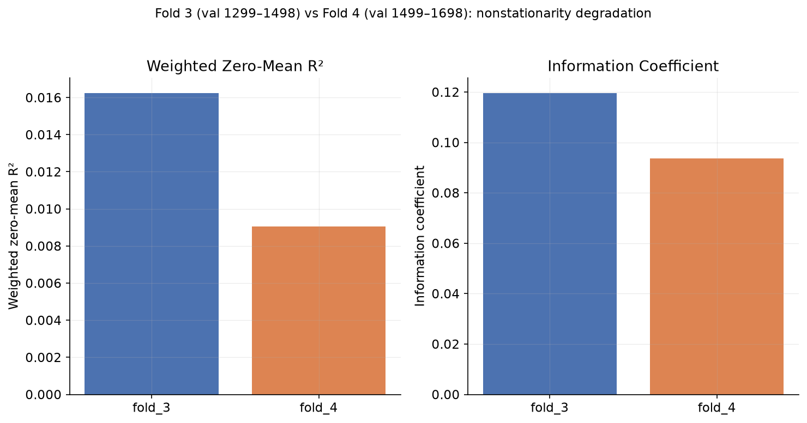
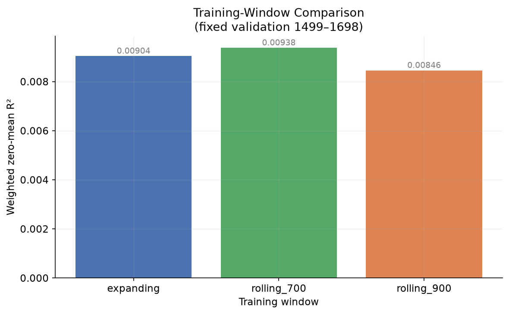
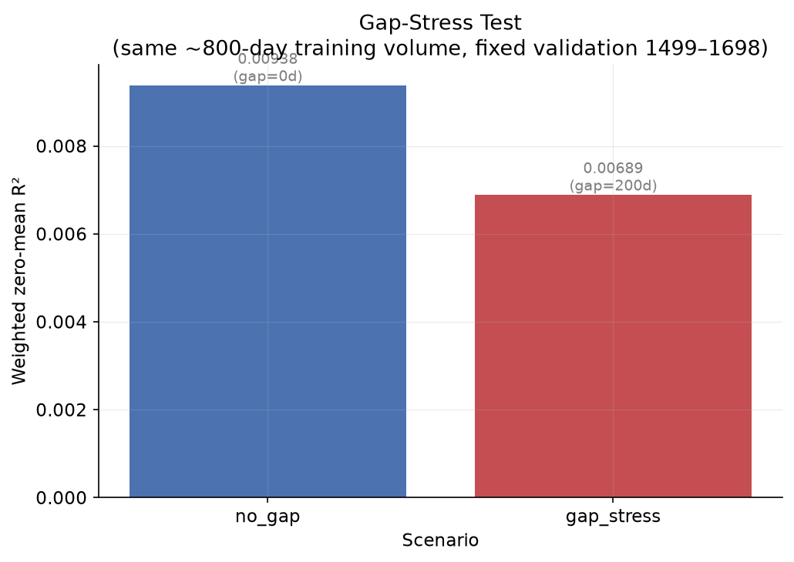
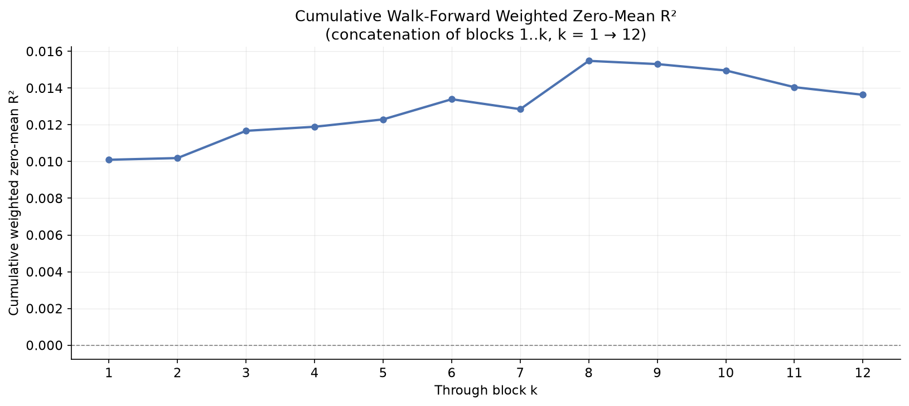
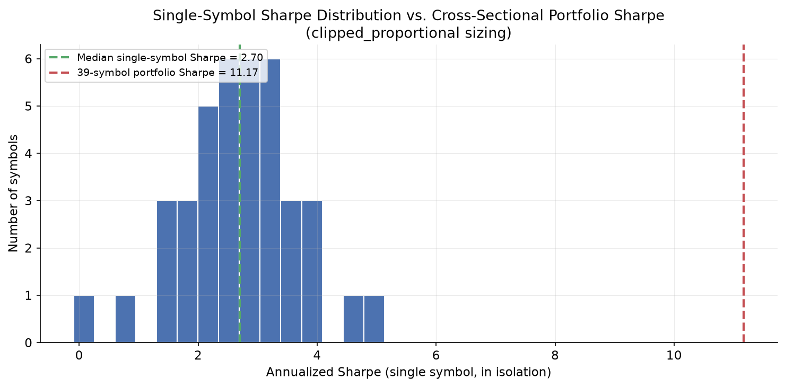
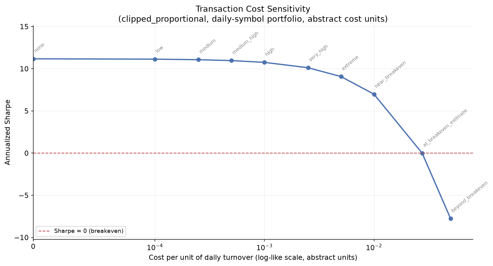

# Jane Street Real-Time Market Data Forecasting — Project Writeup

An end-to-end quantitative research pipeline built on the Jane Street Kaggle
competition dataset: leakage-safe EDA, temporal cross-validation, feature
engineering with ablation testing, a LightGBM forecasting model validated by
walk-forward simulation, a corrected strategy-proxy backtest with transaction-cost
sensitivity, and a production-shaped rolling inference engine.

The throughline of this project is empirical discipline: every modeling decision
— including several that looked like wins at first — was tested under temporal
validation before being accepted, and two serious methodological bugs (a
corrupted data partition, and a strategy backtest that inflated Sharpe from
aggregation artifacts) were caught and fixed rather than rationalized away.

---

## Problem

Predict `responder_6`, an anonymized short-horizon Jane Street forecasting
target, from 79 anonymized market features observed at each
`(date_id, time_id, symbol_id)` cross-section. The competition's primary metric
is **weighted zero-mean R²**:

```
R²_weighted = 1 − Σ wᵢ(yᵢ − ŷᵢ)² / Σ wᵢyᵢ²
```

which compares a model against predicting zero for every observation (not
against the mean), and is sensitive to Jane Street's per-observation `weight`
column. Because the denominator does not depend on the model's predictions,
minimizing weighted squared error is equivalent to maximizing this metric —
directly compatible with LightGBM's standard regression objective.

---

## Data

- **Training data:** 10 Parquet partitions, **47,127,338 rows**, `date_id` 0–1698
  (1,699 unique dates), `time_id` 0–967 (968 unique values, spacing not
  guaranteed to represent equal real elapsed time per Jane Street's own
  documentation), `symbol_id` 0–38 (39 unique instruments — the active symbol
  count grew from 20 to 39 over the dataset's history).
- **Columns:** `date_id`, `time_id`, `symbol_id`, `weight`, `feature_00`–`feature_78`
  (79 predictors), `responder_0`–`responder_8` (target = `responder_6`).
- `responder_6` summary: mean ≈ −0.0021, std ≈ 0.8899, median ≈ −0.0256, roughly
  clipped to [−5, 5].
- `lags.parquet` turned out to be a mock example batch for the Kaggle evaluation
  API, not a usable historical-lag dataset for training — any responder-lag
  features have to be built from the historical responders directly.

---

## Leakage risks

Several distinct leakage/integrity risks were identified and addressed before
any modeling began:

1. **Corrupted data partition.** `partition_id=9` failed to parse in both Polars
   and PyArrow (`Couldn't deserialize thrift`) despite intact PAR1 header/footer
   bytes and a plausible file size — consistent with an incomplete OneDrive
   sync rather than a download error. Re-downloaded directly from Kaggle and
   verified independently before re-running the full-dataset inspection.
2. **Structural (non-random) missingness.** `feature_21/26/27/31` and
   `feature_00–04` are **100% missing before `date_id≈527`**, then near-zero
   missing after — a hard data-availability regime break, not random noise.
   `feature_39/42` show a softer two-regime pattern. This was confirmed via
   per-date and per-symbol missingness analysis and directly shaped the
   preprocessing design (tree models keep native NaNs; linear models get
   missing-indicator columns plus imputation) and the temporal-CV design
   (folds must not pretend these features existed before they did).
3. **Naive lag leakage.** A previous-day responder baseline
   (`responder_6[date-1]` at the same `time_id`/`symbol_id`) was tested
   explicitly and **failed badly** (R² = −0.9751), which both ruled out naive
   lag persistence as a shortcut and served as a leakage-safety sanity check —
   a real bug that accidentally used same-day information would have shown an
   implausibly *good* score here, not a catastrophic one.
4. **Rolling/lag feature construction.** Every historical feature is built via
   `shift(1)` *before* any rolling statistic, using each symbol's own most
   recently **available** trading day (not a naive `date_id − 1`), because
   individual symbols have genuine day-level gaps in the data. A test script
   bug that assumed strict `date_id − 1` semantics was caught (it was silently
   passing without checking anything for the affected symbol) and fixed before
   the module was trusted.
5. **Cross-sectional feature legitimacy.** Cross-sectional market features
   (mean/deviation across symbols at the *same* `(date_id, time_id)`) are not
   look-ahead leakage, because Jane Street's real evaluation API delivers test
   data in per-timestamp cross-sectional batches — every symbol's current-moment
   values are genuinely available before a prediction for that moment is due.
6. **Walk-forward and inference isolation.** The walk-forward simulation
   retrains a fresh model per block (never reusing a model across blocks), and
   the production `RollingInferenceEngine` **structurally rejects** any batch
   spanning more than one `(date_id, time_id)` snapshot — isolation is
   enforced by the code, not just assumed.

---

## EDA / nonstationarity

- **Daily mean of `responder_6`** oscillates tightly around 0 across the full
  history, with occasional sharp single-day shocks (≈ −0.47, ≈ +0.40) — no
  long-run drift, but not pure noise either.
- **Daily cross-sectional volatility** shows clear clustering (heteroskedasticity),
  ranging ~0.6–1.2 with spikes to 2.35, coincident with the mean-shock days.
- **Autocorrelation** of the daily mean target is essentially zero beyond a weak
  lag-1 effect (~−0.12) — ruling out simple ARIMA-style modeling of the
  aggregate target.
- **Symbol-level heterogeneity:** symbol means cluster near zero except for
  clear outliers (symbol 9 ≈ −0.025, symbol 34 ≈ +0.012); volatility ranges
  0.72–1.05 across symbols.
- **Rolling 20/60-day means** reveal the clearest nonstationarity signature:
  multi-month waves of persistently positive or negative regimes, not just
  short-term noise.
- **Feature–target correlation instability:** several features
  (`feature_38`, `76`, `74`, `78`, `25`, and others) **flip sign** between an
  early period (`date_id` 0–300) and a late period (1399–1698) — full-history
  correlation rankings are not trustworthy for feature selection.

This body of evidence is what motivated (a) temporal, never random,
cross-validation, and (b) treating every "does X help" question as an empirical
test rather than an assumption.

---

## Validation design

`src/temporal_cv.py` defines expanding-window folds over `date_id`, verified
against the real dataset (row counts, date-range assertions, zero overlap):

| Fold | Train | Validate |
|---|---|---|
| fold_1 | 0–898 | 899–1098 |
| fold_2 | 0–1098 | 1099–1298 |
| fold_3 | 0–1298 | 1299–1498 |
| fold_4 | 0–1498 | 1499–1698 |

`fold_3`/`fold_4` were used as the fast CPU-development pair, plus a dedicated
**gap-stress fold** (train 0–1298, 200-day gap, validate 1499–1698) built to
directly probe the correlation-instability and regime-shift risk the EDA
surfaced. All CPU-bound development experiments used a deterministic
`time_id`-stride subsample (train stride 40, validation stride 20) rather than
`head(N)`, to preserve the full chronological range, symbol cross-section, and
intraday coverage while keeping training tractable.

---

## Baselines

| Model | Weighted R² | IC |
|---|---|---|
| Zero prediction | 0 (by construction) | — |
| Previous-day responder | **−0.9751** | −0.0017 |
| Weighted linear regression | 0.006446 | 0.0768 |
| Ridge (α=1) | 0.006446 | 0.0768 |
| Elastic Net (α=0.001, l1=0.5) | 0.006389 | 0.0761 |
| **Raw-feature LightGBM** | **0.013528** | **0.1098** |

The previous-day baseline's catastrophic failure ruled out naive persistence.
Ridge and OLS were statistically indistinguishable at this scale, and Elastic
Net underperformed despite 10x the training time. Raw LightGBM more than
**doubled** the linear R² and nearly doubled IC — clear evidence that nonlinear
structure/interactions matter, motivating a move to feature engineering rather
than further linear tuning.

---

## Feature engineering

A compact set of 16 features (chosen from the overlap of linear correlation and
LightGBM gain rankings) was used for all engineered-feature experiments, to
keep runtime and dimensionality manageable:

`feature_06, 04, 07, 59, 36, 49, 60, 38, 01, 52, 58, 05, 68, 02, 47, 08`

| Feature block | Weighted R² | Verdict |
|---|---|---|
| Raw only (control) | 0.013528 | baseline |
| + Cross-sectional (market mean/deviation) | **0.015849** | **kept — real +17% gain** |
| + Per-symbol rolling/lag (144 cols, windows 5/10) | 0.012491 | **rejected — hurts, 2x training time** |
| + Both | 0.015848 | no added value over cross-sectional alone |
| + Compact temporal redesign (24 cols, vs. 0.016244 benchmark) | 0.016241 | **rejected — statistically flat (Δ = −0.0000033)** |

Cross-sectional features (contemporaneous mean/deviation across symbols at each
snapshot) were the only engineered family that added real value. Two different
temporal/rolling designs — a large 144-column block and a much smaller,
carefully-redesigned 24-column block — were both tested and both rejected. The
code for the rejected experiments is kept in the repository (`src/feature_engineering.py`,
scripts 11 and 14) as documented negative results, not deleted.

---

## Model selection

**LightGBM** was selected over the linear family after the raw-feature
comparison above, using a deliberately conservative, fixed starting
configuration (not tuned before establishing the baseline was worth pursuing):
`num_leaves=31, min_child_samples=200, learning_rate=0.03, reg_lambda=1.0,
colsample_bytree=0.80, subsample=0.80, subsample_freq=1`, native missing-value
handling, early stopping on the validation window.

---

## Ablations

### `symbol_id` — the most important lesson in the project

`symbol_id` dominated LightGBM's gain-based feature importance by a **4.6x**
margin over the next-best feature (229,867 vs. 50,314) in every early
experiment. An ablation test removed it and compared:

| Model | `symbol_id`? | Weighted R² |
|---|---|---|
| raw | yes | 0.013528 |
| raw | **no** | **0.014665** |
| raw + cross-sectional | yes | 0.015849 |
| raw + cross-sectional | **no** | **0.016244** |

**Removing `symbol_id` improved generalization in both pairings.** Despite
dominating in-sample gain, it was net negative for forward-period performance —
a textbook demonstration that feature importance measures in-sample reliance,
not out-of-sample usefulness. This became the project's new champion
specification: **raw + cross-sectional − `symbol_id`**, R² = 0.016244.

### Hyperparameter search

A curated set of 10 configurations (each varying exactly one hyperparameter
away from the baseline, not a 162-model grid) was tested against a
pre-registered acceptance rule: a change only counts as "meaningfully better"
if it beats the baseline by **≥ +0.0003 R²**. The closest contender
(`learning_rate=0.02`) only reached +0.000259 — short of the bar, and at 2.5x
the training cost. **No configuration cleared the threshold**, so the original
baseline hyperparameters were locked as final rather than adopting a
statistically-noise-level "improvement."

---

## Walk-forward simulation



Before trusting a single train/validate split, the locked specification was
validated across multiple folds and stress scenarios:

**Fold 3 vs Fold 4** (same specification, later validation window):



| Fold | Weighted R² | IC | Directional accuracy |
|---|---|---|---|
| fold_3 | 0.016244 | 0.1196 | 0.5351 |
| fold_4 | 0.009040 | 0.0936 | 0.5262 |

Fold 4 retained only ~56% of fold 3's R² — real, positive, but degrading
signal, consistent with the EDA's nonstationarity findings.

**Training-window comparison** (fixed validation 1499–1698):



`rolling_700` (train 700–1498) modestly beat the full expanding window
(0.009376 vs 0.009040, +3.7%), while `rolling_900` (even shorter) did worse
than both — a real but small effect, and non-monotonic, so **shorter is not
automatically better**. `rolling_700` was locked as the default training
window.

**Gap-stress test** (~800 days of training either way, only the gap to
validation differs):



| Scenario | Gap | Weighted R² |
|---|---|---|
| no_gap (train 700–1498) | 0 days | 0.009376 |
| gap_stress (train 500–1298) | 200 days | 0.006887 (**−26.55%**) |

A 200-day staleness gap cost far more than an equivalent reduction in training
volume — recency of training data matters substantially, which directly
motivated making periodic retraining a first-class part of the final design
rather than an afterthought.

**Full walk-forward simulation:** 12 sequential blocks, 700-date rolling
training window, 50-date prediction blocks, a **fresh model retrained from
scratch every block**, spanning `date_id` 1099 → 1698:



- **Aggregate weighted R² = 0.013633**, IC = 0.111964, across **1,122,737**
  concatenated genuinely out-of-sample predictions.
- **12/12 blocks positive** (range 0.0064–0.0304) — the model never failed
  outright across 600 days of sequential, never-before-seen data.
- Cumulative performance rises through block 8 (a standout block, R²=0.030)
  then gently decays to 0.0136 by block 12 — a healthy, gradual decay
  signature, not a cliff.
- Blocks 9–12 (the same calendar window as the static fold-4 test) average
  R²≈0.0098 — only modestly better than the static result, confirming
  retraining helps but does not fully erase the underlying regime-shift
  difficulty.

---

## Strategy proxy

Converting predictions into a trading rule surfaced the project's second major
caught bug. A first attempt (position = f(prediction), P&L aggregated by
`date_id` across all ~39 symbols × ~20 intraday snapshots) produced an
**annualized Sharpe of 20–24 with a 97% daily hit rate** — both far outside any
credible range (rough scale: 0–1 weak, 2–3 excellent, 4–5+ very unusual, 20+
almost certainly a construction artifact), despite the forecasting model itself
only having ~53% observation-level directional accuracy. The mechanism:
averaging ~780 quasi-independent, slightly-positive-expectation bets per day
collapses daily variance by the law of large numbers (σ ≈ σ/√N) while the mean
survives, mechanically inflating Sharpe.

**Fix:** collapse each symbol's intraday observations to **one position per
`(date_id, symbol_id)`** (mean prediction, mean realized responder, **mean**
weight — not sum, to avoid over-weighting frequently-sampled symbols) *before*
computing any P&L, with sparse-symbol-aware turnover (each symbol compared to
its own most recent available prior date).

| Sizing rule | Sharpe | Max drawdown | Hit rate | Daily turnover |
|---|---|---|---|---|
| sign | 10.06 | −0.138 | 0.808 | 0.95 |
| proportional | 10.61 | −0.254 | 0.812 | 1.45 |
| **clipped_proportional** | **11.17** | −0.158 | 0.812 | 1.44 |

A second bug was caught during this fix (a clip threshold computed on the raw
intraday prediction distribution never activated on the much-narrower
symbol-day-averaged distribution, silently making `clipped_proportional`
degenerate into plain `proportional`) and corrected before trusting the result.

**Single-symbol decomposition** — separating genuine predictive edge from
diversification:



| | Value |
|---|---|
| Median single-symbol Sharpe | **2.70** |
| Mean / std | 2.70 / 1.00 |
| Min / Max | −0.09 / 5.13 |
| % symbols positive | 97.4% (38/39) |
| Portfolio Sharpe | 11.17 |
| Diversification multiple | **4.15x** |

An independent reconciliation (equal-weight average of each symbol's own
return series vs. the actual weighted portfolio construction) correlated 0.87
and produced a similar Sharpe (9.92 vs. 11.17) — confirming the result isn't an
artifact of one specific aggregation path. **This is the coherent, defensible
story**: a modest, believable per-instrument edge (median Sharpe 2.70), with
the portfolio Sharpe substantially explained by genuine cross-sectional
diversification across ~39 symbols, not a hidden methodology bug.

---

## Cost sensitivity



Rather than pick one arbitrary transaction-cost assumption, `cost_d = c ×
turnover_d` was swept across abstract cost levels (turnover ≈ 1.44/day):

| Cost level | c | Sharpe | Max DD |
|---|---|---|---|
| none | 0 | 11.17 | −0.16 |
| high | 0.001 | 10.75 | −0.16 |
| very_high | 0.0025 | 10.12 | −0.18 |
| extreme | 0.005 | 9.06 | −0.22 |
| near_breakeven | 0.01 | 6.97 | −0.33 |
| **at_breakeven_estimate** | **0.0275** | **−0.01** | −2.33 |
| beyond_breakeven | 0.05 | −7.77 | −19.45 |

The simulated Sharpe crosses to ≈0 almost exactly at the analytically-estimated
breakeven cost (validating that approximation), then goes sharply negative
beyond it. The edge is **robust to small/moderate friction but not
unconditionally durable** — and because `responder_6`'s units are anonymized,
where real trading costs would actually fall on this abstract scale is
unknown. This sensitivity curve, not a single Sharpe number, is the honest
deliverable of this analysis.

**Required wording for every strategy number in this project:**
> "Annualized Sharpe of 11.17 on a responder-based long/short strategy proxy in
> walk-forward simulation, substantially explained by cross-sectional
> diversification (median single-symbol Sharpe 2.70)."

**Never:** "This trading strategy would have made a Sharpe of 11.17."

---

## Rolling inference

`src/inference.py`'s `RollingInferenceEngine` reproduces the real deployment
information flow: a `(date_id, time_id)` batch arrives → contemporaneous
cross-sectional features are constructed *from that batch alone* → the locked
model predicts → identifiers are preserved → advance to the next timestamp. No
multi-day history store is required, because the rejected temporal/rolling
feature blocks would have been the only thing needing one.

Verified via 7 categories of tests, all passing against a model trained on
`[799, 1498]` and tested purely on unseen `date_id ≥ 1499`:

1. **Batch isolation** — single-snapshot batches accepted; a multi-snapshot
   batch is **actively rejected**, not just coincidentally correct.
2. **Feature equality** — matches an independent manual cross-sectional
   recomputation.
3. **Prediction equality** — matches a direct `model.predict()` call exactly.
4. **Row/order preservation** — row count and identifier order preserved.
5. **No `symbol_id` leakage** — absent from the 112-feature model schema,
   present only as output metadata.
6. **Feature schema enforcement** — exact expected count, no duplicates;
   dropping a required column correctly **raises** instead of silently
   predicting.
7. **Sequential batches** — 1,936 distinct snapshots across 2 dates processed
   with zero state leakage between batches.

The locked model (trained on all available recent history with a fixed
iteration count, since a deployed model has no future slice left to hold out
for early stopping) is saved at `models/locked_lightgbm_model.joblib`.

---

## Limitations

- **`responder_6` is anonymized.** Every Sharpe/drawdown/P&L number in this
  project is a strategy-*proxy*, not a literal tradable-return backtest. We do
  not know that responder units correspond to a real percentage return.
- **No transaction costs, slippage, or capacity constraints** are modeled in
  the gross strategy numbers; the cost-sensitivity sweep is an abstract
  sensitivity analysis, not a calibrated real-world cost estimate.
- **Possible correlation among the 39 anonymized instruments is unknown** —
  if some are economically related (e.g., derivatives on the same underlying),
  the diversification multiple (4.15x) may be somewhat overstated.
- **CPU-only development** used a deterministic `time_id` stride for
  tractability in most experiments; results are not derived from the full
  unstrided dataset in every case (though final walk-forward predictions used
  the full historical range with a stride only at inference density).
- **Training window (700 dates) and retrain cadence (every 50 dates)** were
  each chosen from a small number of tested alternatives, not an exhaustive
  search.
- **Only LightGBM** was pursued as the nonlinear model family; XGBoost and
  neural network architectures were not explored.
- **Leakage-safe multi-day responder-history features** were part of the
  original roadmap but never built, since the naive previous-day baseline
  failed so badly that the idea was deprioritized in favor of cross-sectional
  features, which tested well.
- The production model's fixed iteration count (500) was chosen heuristically
  from prior experiments' typical best-iteration values, not independently
  cross-validated.

---

## Final conclusions

Starting from a linear baseline of R² ≈ 0.0064, the locked specification
(**raw features + cross-sectional market features − `symbol_id`**, LightGBM
with `num_leaves=31, learning_rate=0.03, min_child_samples=200,
reg_lambda=1.0, colsample_bytree=0.80, subsample=0.80`, rolling 700-date
training window) reached **R² ≈ 0.016 on its best validation window** and
**R² ≈ 0.0136 aggregated across a genuine 600-day walk-forward simulation**
with 12/12 positive out-of-sample blocks.

Converting those predictions into a strategy proxy produced an initially
implausible Sharpe (20+) that was correctly diagnosed as an aggregation
artifact and repaired into a defensible, decomposed result: a modest
per-instrument edge (median single-symbol Sharpe 2.70) amplified by genuine
cross-sectional diversification (4.15x) into a portfolio Sharpe of 11.17 —
robust to small trading friction but fully erodible beyond an identifiable
(if unit-less) breakeven cost. A production-shaped rolling inference engine,
verified end-to-end against the historical data, closes the loop from raw
features to a single per-observation prediction with no look-ahead
possibility.

The project's core discipline throughout was **not accepting a metric at face
value** — the `symbol_id` ablation and the strategy-Sharpe correction are both
direct examples of catching a result that looked good, asking what assumption
could produce it, and only trusting the number once that question had a real
answer.
